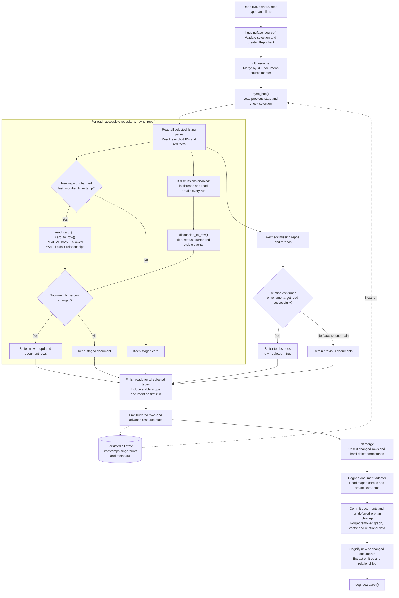

# Hugging Face Hub connector for cognee

Ingest model cards, dataset cards, Space READMEs, discussions and pull requests
as searchable documents using the official `huggingface_hub.HfApi` client.
Only README files and discussion text are read: no weights, dataset files or
Space source code are downloaded. Implements the connector for
[cognee#5795](https://github.com/topoteretes/cognee/issues/5795).

## How the code works

The connector reads the Hub and prepares document rows. dlt merges those rows
into staging, then Cognee turns them into searchable memory.



`_request()` wraps Hub reads: it retries 429 responses using `Retry-After`.
A 401/403 retains the affected repository's prior documents; an unhandled error
aborts the run before buffered rows or state updates are emitted. Downloads,
likes and timestamps stay in resource-state metadata rather than document text.
Thread details are checked independently of card timestamps so comment-only
changes are detected. The stable scope document lets orphan cleanup work even
after the final real repository is deleted.

## Install and test locally

Install uv and use Python 3.11 or 3.12. From the repository root:

```bash
cd packages/connector/huggingface
uv sync --python 3.11
uv run pytest tests/ -q
uv run ruff check .
uv run ruff format --check .
```

Tests use local fixtures and injected clients, including real dlt/SQLite merge
tests and Cognee document routing. No Hub token or LLM calls are needed.

## Usage

```python
import cognee
from cognee_community_connector_huggingface import huggingface_source

await cognee.remember(
    huggingface_source(
        owners=["your-user-or-organisation"],
        repo_types=["model", "dataset", "space"],
        # token="hf_...",  # optional; HF_TOKEN / saved Hub credentials also work
    ),
    dataset_name="hub_docs",
    primary_key="id",
    write_disposition="merge",
    max_rows_per_table=0,
)

answer = await cognee.search(
    query_text="Which models use our old training dataset?",
    query_type=cognee.SearchType.GRAPH_COMPLETION,
    datasets=["hub_docs"],
)
```

Selectors:

- `owners`: user/organisation names, with fully consumed paginated listings.
- `repo_ids`: explicit repo IDs, applied to each selected repo type. Combined
  with owner/search results as a union. For unrelated explicit IDs of different
  types use separate source selections/datasets.
- `repo_types`: any of `model`, `dataset`, `space`; defaults to model only.
- `search`, `task`, `library`, `tags`: narrow listings using Hub search/tags.
  Hub filters vary by repository type; choose filters appropriate to that type.
- `include_discussions=False`: ingest only cards; default includes threads/PRs.
- `client`: injected HfApi-compatible client, useful for offline testing.

Keep a selection and its dataset stable across runs. Changing a persisted
selection raises an error; use another dataset/pipeline instead. Always pass
`write_disposition="merge"` to `remember`, whose own default is `replace`.

## Runnable example

Public repositories work without a Hub token. For private/gated content, supply
a token with the required read access. Cognee ingestion/search requires your
configured LLM provider (the default uses `LLM_API_KEY`).

```bash
export LLM_API_KEY="your-key"
# Optional: export HF_TOKEN="your-read-token"
uv run python examples/example.py --repos openai-community/gpt2 --no-discussions

# Sync your own account and all repository types, including discussions:
uv run python examples/example.py --owners your-user --repo-types model dataset space
```

Re-run the same command after editing a card, adding/editing/removing a comment,
closing a thread, renaming a repository or deleting one. The example keeps its
Cognee dataset and does not prune existing memory. Provider calls may incur costs.

## Documents, relationships and metadata

Each card/thread is one document with `id`, `title`, `url`, `content` and a hard
delete flag. IDs include type and repo ID, e.g. `model:owner/name:card` and
`model:owner/name:discussion:12`. `DOCUMENT_SOURCE_ATTR="huggingface"` routes
these through Cognee's ordinary document/cognify path.

Card YAML is parsed with `RepoCard`. Only `license`, `base_model`, `datasets`,
`language`, `tags`, `pipeline_tag` and `library_name` become readable text. Nested
YAML/evaluation/widget payloads are excluded; the Markdown card body is retained.
Owner, base-model and dataset relationships are explicit sentences with repo
links. Threads identify their parent repo and include title/status/author and
comment, status, title-change and commit events. Hidden comment content and old
comment edit history are excluded. Entity/relationship extraction follows
Cognee's configured LLM; these are not deterministic foreign-key graph edges.

Downloads, likes, creation dates and modification timestamps are saved as
**dlt resource-state metadata**, under `<repo_type>.repos.<repo_id>.metadata`.
They are excluded from document rows/content hashes, avoiding graph churn when
counts change. Cognee 1.4.0's document adapter does not forward custom row metadata
to `DataItem.external_metadata`; provenance there contains source/title/URL/ID.

## Incremental sync and deletion

State records timestamps and document fingerprints per repository type/repo.
Only new/changed cards are downloaded; unchanged rendered documents are not
emitted. A newly discovered repo is read even if its timestamp is older than the
per-type high-water mark. All listing pages are consumed on every run.

**Discussion API limitation:** the Hub listing exposes creation time, not a
reliable last-activity timestamp. Details are checked every run to detect edits,
deleted comments and status changes independently of card edits. Fingerprints
ensure only changed thread documents are merged/re-ingested; timestamps are
also retained in `discussion_activity`. This avoids silently missing comments
at the cost of a detail request per thread per sync.

Missing repos are rechecked before deletion: changing a tag/search match alone
does not delete a repo. Redirects ingest the canonical ID and tombstone old card
and thread IDs. Missing repos with a 404 are tombstoned only when a broad
read/write token proves continued access to the owner (same account or current
organisation membership). Anonymous/fine-grained-token reads cannot prove that
access, so ambiguous disappearance is logged and retained. A 401/403 preserves
previous state/documents. This intentionally favours retention over a false
deletion after permission loss. A private repo still readable with the supplied
token remains in scope; one made inaccessible is handled with these same rules.

429 responses honour `Retry-After` (seconds or HTTP date), with a bounded retry
budget, including failures on later listing pages. A 5xx or other unhandled
error aborts before emitting rows, tombstones or updated state. The run is
buffered in memory to make that guarantee.

dlt hard-delete merge removes tombstoned rows; Cognee's deferred orphan cleanup
reconciles its graph/vector/relational stores afterward. A small stable scope
document remains in staging, because Cognee 1.4.0 skips cleanup for an empty
readback. This enables deletion of the final real repo without modifying core.

## Manual acceptance check

Use a test account with a broad **read** token owned by that account. Create two
small repos with cards and a discussion using the Hub UI. Sync, edit one card,
add a comment without editing a card, then sync again. Check search results.
Delete one repo and rename the other, sync again, and check old documents are
forgotten. Repeat for dataset/Space cards and a read-only public organisation.
The connector itself only performs reads against the Hub.
